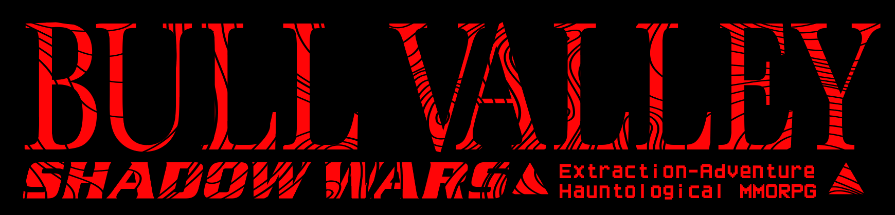

An adventure RPG set in a hauntological Bull Valley, Illinois. 3D first-person in the browser with a PS1 look, and one persistent valley that every raider online shares. Play at https://bvsw.net. A phone opens Bull Valley Dial-Up, the same account and valley without a body.

## Run it

Node 22.13 or later.

```bash
npm ci
```

```bash
npm run db:migrate
```

```bash
npm run dev
```

Open http://localhost:5174 and sign in with the Dev provider. Open a second window to meet yourself in the valley. A new account asks for the magic word: on a dev server it is "berries".

## Check it

```bash
npm run typecheck
```

```bash
npm run lint
```

```bash
npm test
```

```bash
npm run test:e2e
```

The e2e suite needs Chromium once: `npx playwright install chromium`.

## Stack

- Client: TypeScript, three.js, Vite. Two apps from one entry (`src/entry.ts`): the 3D valley and Bull Valley Dial-Up.
- Server: one Cloudflare Worker and one Durable Object, `ValleyDO`, that runs the shared world's pure reducer (`src/sharedworld.ts`).
- Data: Cloudflare D1 for accounts, packs, wallets and everything else an account keeps.
- Deploys: GitHub Actions only, after green CI on `main`.

## Docs

- [CLAUDE.md](CLAUDE.md): the standing rules and where to read next.
- [docs/tooling.md](docs/tooling.md): every command, CI, deploys, secrets.
- [docs/gameplay.md](docs/gameplay.md): what a raider sees and does.
- [docs/multiplayer.md](docs/multiplayer.md): the Worker, the wire, D1, auth, and the shared world's rules.
- [docs/modules.md](docs/modules.md): one line for every module under `src/` and `worker/`.
- [docs/testing.md](docs/testing.md): driving the game in a browser and the e2e shards.
- [COPY.toml](COPY.toml): every player-facing line.
